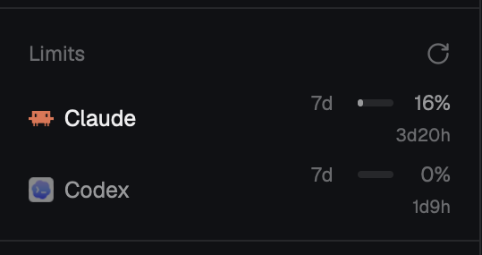
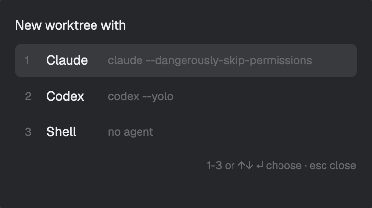
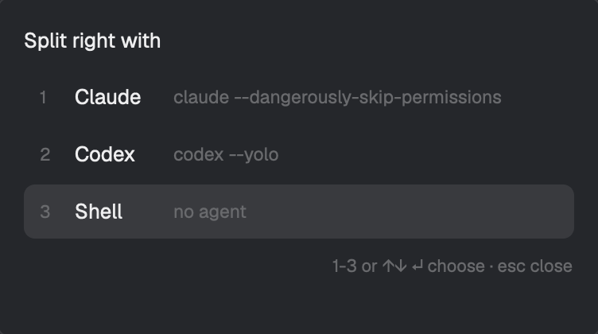
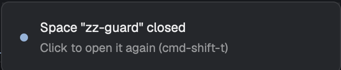

# herdr-app-config

[Herdr](https://herdr.dev) 데스크톱 앱(`herdr-app`)에 추가한 mod와 단축키 모음입니다. herdr-app 0.1.12에서 만들고 확인했습니다.

## 기능

### Claude, Codex 사용량 패널



사이드바 Agents 목록 바로 아래에 Limits 패널이 붙습니다. 에이전트마다 한 줄씩, 짧은 한도(5h)와 긴 한도(7d)를 막대와 퍼센트로 보여주고, 그 아래에 초기화까지 남은 시간(`45m`, `2h15m`, `3d20h`)을 보여줍니다. 플랜에 5h 한도가 없으면 그 칸은 비어 있습니다.

- 70% 이상이면 주황, 90% 이상이면 빨강으로 바뀝니다.
- 줄에 마우스를 올리면 각 한도가 리셋되는 시각과 마지막 갱신 시각이 나옵니다.
- 로컬 기록은 30초마다, Anthropic과 OpenAI 서버는 5분마다 확인합니다. 오른쪽 위 새로고침 아이콘을 누르면 바로 다시 확인합니다.
- 지금 실행 중이 아닌 에이전트는 흐리게 보입니다.

### 새 worktree를 만들 때 에이전트 고르기



`cmd-shift-n`을 누르면 새 worktree에서 무엇을 띄울지 먼저 묻습니다. 고르고 나면 Herdr 기본 New worktree 다이얼로그가 열리고, 브랜치 이름을 입력하면 새 스페이스가 만들어지면서 고른 에이전트가 바로 실행됩니다. 스페이스 메뉴의 "New worktree"와 같은 다이얼로그이고, 지금 보고 있는 스페이스의 저장소를 기준으로 합니다.

### 화면을 나눌 때 에이전트 고르기



`cmd-d`(오른쪽), `cmd-shift-d`(아래)로 pane을 나눌 때도 같은 창이 뜹니다. 키를 누를 때 포커스가 있던 pane 옆에 새 pane이 열리고 고른 에이전트가 실행됩니다. 그냥 셸만 열려면 Shell을 고르면 됩니다.

| 키 | 동작 | 선택지 |
| --- | --- | --- |
| `cmd-shift-n` | 지금 스페이스의 저장소로 새 worktree 만들기 | Claude, Codex, Shell |
| `cmd-d` | 오른쪽으로 분할 | Claude, Codex, Shell |
| `cmd-shift-d` | 아래로 분할 | Claude, Codex, Shell |
| `cmd-shift-t` | 마지막에 닫힌 스페이스 다시 열기 | |

선택지마다 실행하는 명령은 아래와 같습니다.

- Claude: `claude --dangerously-skip-permissions`
- Codex: `codex --no-daemon --yolo`. `--no-daemon`이 있어야 Codex 명령이 herdr 터미널 안에서 실행되고 `hc send` 같은 협업 명령이 동작합니다.
- Shell: 에이전트 없이 기본 셸

선택 창에서는 `1`~`3`을 누르거나 `↑↓`로 고른 뒤 `↵`를 누릅니다. 클릭해도 됩니다. `esc`를 누르면 닫힙니다. 마지막에 고른 항목은 키마다 따로 기억합니다.

### 폴더를 골라 스페이스 열기


사이드바 Spaces 제목줄의 `+` 왼쪽에 폴더 버튼이 생깁니다. 누르면 macOS 폴더 선택 창(Finder)이 열리고, 고른 폴더에서 새 스페이스가 시작됩니다. `+`는 원래대로 홈 폴더에서 새 스페이스를 엽니다.

- 이 컴퓨터의 폴더만 고를 수 있습니다. 원격 머신의 스페이스는 기존 `+`나 "New space there"로 엽니다.
- Herdr 기본 `spaces` mod는 직접 고칠 수 없어서 `install.sh`가 설치할 때마다 기본 mod를 `spaces-plus`로 새로 복제하고 `patches/spaces-plus.py`로 폴더 버튼과 그룹 모드를 넣습니다. Herdr가 업데이트되면 `config-sync`가 이 과정을 자동으로 다시 합니다. Herdr가 그 부분 코드를 바꿔 패치가 실패하면 이전 `spaces-plus`를 그대로 씁니다.

### 스페이스를 그룹으로 묶기


Spaces 제목줄의 폴더 버튼 왼쪽에 그룹 버튼(겹친 사각형)이 생깁니다. 누르면 그룹 모드가 켜지고, This computer의 스페이스를 개인, 회사처럼 직접 만든 그룹 아래에 모아 보여줍니다. 다시 누르면 원래 목록으로 돌아갑니다.

- 목록 맨 아래 `New group`을 누르고 이름을 입력한 뒤 `↵`를 누르면 그룹이 생깁니다. `esc`를 누르거나 다른 곳을 누르면 취소됩니다.
- 스페이스를 그룹 헤더 위로 끌어다 놓으면 그 그룹에 들어갑니다. 다른 그룹의 스페이스 위에 놓으면 그 자리로 옮겨지면서 그 그룹에 들어갑니다. 그룹에서 빼려면 드래그하는 동안 나타나는 `Ungrouped` 헤더에 놓습니다.
- 그룹 헤더를 누르면 접고 펼칩니다. 우클릭하면 이름을 바꿀 수 있고, 이름을 비우고 `↵`를 누르면 그룹이 지워지고 그 안의 스페이스는 `Ungrouped`로 갑니다.
- worktree 스페이스는 원래 저장소 스페이스 아래에 붙어서 그 그룹을 따라갑니다.
- 원격 머신의 스페이스는 그룹에 넣지 않고 지금처럼 머신 헤더 아래에 둡니다. 사이드바를 좁게 접은 상태에서는 그룹 없이 보입니다.
- 그룹은 스페이스 id로 기억합니다. 스페이스를 닫았다가 `cmd-shift-t`로 다시 열면 새 스페이스가 되어 그룹에서 빠집니다.

### 닫힌 스페이스 다시 열기



`cmd-w`, `cmd-shift-w`로 마지막 터미널을 닫으면 앱이 먼저 확인을 묻습니다. 하지만 스페이스의 마지막 셸에서 `exit`나 `ctrl-d`로 셸이 끝나면 묻지 않고 스페이스가 바로 사라지고, 앱에는 그걸 다시 여는 화면이 없습니다.

`space-guard` mod가 이 경우를 받아 줍니다. 스페이스가 사라지면 오른쪽 아래에 `Space "<이름>" closed` 알림이 뜹니다. 알림을 클릭하거나 `cmd-shift-t`를 누르면 같은 이름과 폴더로 스페이스를 다시 엽니다. `cmd-shift-t`는 최근에 닫힌 것부터 10개까지 차례로 엽니다.

- 다시 열리는 건 스페이스와 셸 하나입니다. 탭, 분할, 실행 중이던 에이전트는 돌아오지 않습니다.
- 확인 창을 거쳐 일부러 닫은 스페이스에도 알림이 뜹니다. 무시하면 됩니다.
- 원격 머신 연결이 끊겨 그 머신의 스페이스가 안 보이게 된 건 닫힌 것으로 치지 않습니다.
- 레이아웃에 보이지 않는 블록(높이 0)으로 들어가 있어서 `main-limits` 레이아웃에서만 동작합니다. 닫힌 목록은 앱을 다시 시작하면 비워집니다.

### Herdr 업데이트 후 자동 재적용

Herdr는 업데이트할 때 기본 레이아웃과 기본 mod만 새 버전으로 바꾸고, 복제본(`main-limits`, `spaces-plus`)은 옛 버전 그대로 둡니다. `config-sync` mod가 앱을 시작할 때 Herdr 버전을 확인해서, 마지막으로 설정을 적용한 버전과 다르면 `install.sh`를 혼자 다시 실행합니다. 그러면 새 버전의 레이아웃과 Spaces를 다시 복제해 Limits 패널, 폴더 버튼, 그룹 모드, 보이지 않는 블록을 다시 넣습니다.

- 시작할 때 `Herdr <버전>: re-applying config`, 끝나면 `Config re-applied (Herdr <버전>)` 알림이 뜹니다.
- Herdr가 Spaces 코드를 바꿔 spaces-plus 패치가 실패하면, 이전 `spaces-plus`를 그대로 두고 나머지를 적용한 뒤 `Config re-applied with a warning` 알림을 띄웁니다. 이전 것도 없으면 기본 Spaces를 씁니다.
- 실패하면 `Config re-apply failed` 알림을 띄우고 같은 버전에서는 다시 시도하지 않습니다. 로그는 `~/.local/state/herdr-app-config/sync.log`에 있습니다. 원인을 고친 뒤 `install.sh`를 직접 실행하면 됩니다.
- 저장소를 `git pull`하지는 않습니다. 이 컴퓨터에 있는 저장소 그대로 다시 적용합니다.
- 상태 파일은 `~/.local/state/herdr-app-config/`에 있습니다. `repo`(저장소 위치), `applied`(마지막으로 적용한 Herdr 버전), `attempted`, `announced`, `sync.log`입니다.

### Claude와 Codex 협업 템플릿

herdr-core(`hc`) 템플릿 네 개입니다. 한 에이전트가 다른 에이전트를 자식으로 띄워 일을 맡기고, 자식은 끝나면 `hc send`로 결과를 부모에게 보냅니다.

| 템플릿 | 실행 명령 | 역할 |
| --- | --- | --- |
| `codex-reviewer` | `codex --no-daemon --yolo` | 읽기 전용 리뷰. 범위가 없으면 `git diff HEAD`를 봅니다. |
| `codex-worker` | `codex --no-daemon --yolo` | 정해진 작업 하나를 구현하고 바꾼 파일과 검증 결과를 보고합니다. |
| `claude-reviewer` | `claude --dangerously-skip-permissions` | Codex가 리더일 때 쓰는 읽기 전용 리뷰. |
| `codex-image` | `codex --no-daemon --yolo` | Codex 내장 이미지 생성과 편집. 지정한 경로에 저장하고 원본은 덮어쓰지 않습니다. 저장 경로와 픽셀 크기를 보고합니다. |

템플릿은 `~/.config/herdr-core/templates/<이름>.md` 파일 하나입니다. 위쪽 frontmatter에 `name`, `description`, `command`가 있고, 본문은 에이전트에게 줄 규칙입니다. `hc run <이름> "<작업>"`을 실행하면 `command`로 에이전트를 띄우고, 본문과 작업을 합친 내용을 첫 메시지로 보냅니다.

```markdown
---
name: codex-reviewer
description: Codex reviews a change or files read-only and reports findings
command: codex --no-daemon --yolo
---
You are a code reviewer working for the agent that started you.
...
```

사용할 때는 Claude에게 이렇게 말하면 됩니다.

```
codex-reviewer 템플릿으로 지금 diff 리뷰 맡겨줘
```

Claude가 실행하는 명령은 아래와 같고, 보고는 `<hc from="t16 review">...</hc>` 형태로 Claude 입력창에 들어옵니다.

```sh
hc run --bg --name review --cwd "$PWD" codex-reviewer "Scope: src/x.ts"
hc wait --children any
```

### 이미지 작업을 Codex에 자동으로 넘기기

`~/.claude/CLAUDE.md`에 아래 규칙을 넣어 두면, herdr 안에서 Claude에게 이미지 생성이나 편집을 시켰을 때 Claude가 직접 그리지 않고 `codex-image`로 Codex에 맡깁니다. 결과 파일은 Claude가 열어서 확인한 뒤 씁니다. CLAUDE.md는 개인 설정 파일이라 `install.sh`가 건드리지 않으니 직접 붙여 넣어야 합니다.

````markdown
## Image work goes to Codex

When `$HC_TERMINAL_ID` is set (running inside herdr), do not generate or edit raster images yourself. Delegate to Codex with the `codex-image` template:

```sh
hc run --bg --name image --cwd "$PWD" codex-image "<what to make or change, input file paths, output path>"
hc wait --children any
```

- Give an absolute output path. Never let it overwrite an input image.
- If the launch JSON has `first_message.sent: false`, run `hc read image` and clear the dialog: "Trust this folder?" takes `hc keys image enter`; "Hooks need review" takes `hc keys image down down enter` (Continue without trusting). Once it is idle, send the template body plus the task with `hc send image "<task>"`, since the first message was lost.
- When the report arrives, open the saved file with Read to check it before using it.
- Outside herdr (`$HC_TERMINAL_ID` unset), say that image generation needs Codex in herdr instead of drawing it with code.
- Diagrams, charts and SVG built from code are not image work; do those yourself.
````

Claude에게는 평소처럼 말하면 됩니다.

```
public/og.png로 1200x630 OG 이미지 만들어줘. 초록 톤, 가운데에 서비스 이름
assets/hero.jpg 배경만 흰색으로 바꿔서 assets/hero-white.jpg로 저장해줘
```

결과를 어디에 둘지 경로를 말해 주면 그대로 저장되고, 말하지 않으면 `./generated-images/`에 저장됩니다.

- `hc templates`를 실행하면 설치된 템플릿 목록이 나옵니다.
- Codex가 어떤 폴더를 처음 열면 "Trust this folder?" 확인 창이 떠서 첫 메시지가 전달되지 않습니다. 이때는 `hc read <이름>`으로 화면을 확인하고 `hc keys <이름> enter`로 승인한 다음 작업을 다시 보내면 됩니다. 한 번 승인한 폴더에서는 다시 뜨지 않습니다.
- 둘이 같은 폴더에서 동시에 파일을 고치면 서로 덮어씁니다. 구현은 한쪽만 하고, 둘 다 고쳐야 하면 worktree를 나누세요.

## 설치

### 필요한 것

- macOS와 herdr-app. 설치 중에 herdr-app이 켜져 있어야 합니다.
- `git`, `jq`, `python3`. 최근 macOS에는 `/usr/bin/jq`가 기본으로 들어 있고, `python3`는 `xcode-select --install`로 설치됩니다.
- 선택지로 쓸 `claude`, `codex` CLI. 사용량 패널에는 Claude Code나 Codex 로그인이 필요합니다.

### 설치 순서

1. herdr-app을 엽니다.
2. 터미널에서 저장소를 받고 설치 스크립트를 실행합니다.

   ```sh
   git clone https://github.com/siu9068/herdr-app-config.git ~/Projects/herdr-app-config
   sh ~/Projects/herdr-app-config/install.sh
   ```

3. 끝에 `done: mods, keys (...), layout main-limits`가 출력되면 설치된 것입니다. 사이드바 아래에 Limits 패널이 보이고 위 단축키가 바로 동작합니다.

### install.sh가 하는 일

1. `mods/` 아래 mod 여섯 개를 먼저 `herdr-app check`로 검사하고, 모두 통과하면 `~/.config/herdr-app/mods/`에 복사합니다. 같은 이름의 mod가 있으면 이 저장소 것으로 바꿉니다. 하나라도 검사에 실패하면 아무것도 바꾸지 않고 멈춥니다.
2. `keys.json`의 단축키 네 개를 `~/.config/herdr-app/keys.json`에 합칩니다. 원래 파일은 `keys.json.bak`으로 남습니다.
3. `templates/`의 템플릿 네 개를 `~/.config/herdr-core/templates/`에 복사합니다.
4. Herdr 기본 `spaces` mod를 복제해 폴더 버튼과 그룹 모드를 넣고, 성공하면 `spaces-plus`로 바꿔 넣습니다. 실패하면 이전 `spaces-plus`를 그대로 둡니다.
5. 설치된 버전의 기본 레이아웃 `main`을 `main-limits`로 복제하고, Agents 블록 바로 아래에 Limits 블록과 보이지 않는 space-guard, config-sync 블록을 넣고 Spaces 블록을 `spaces-plus`로 바꿉니다. 기본 레이아웃은 직접 고칠 수 없어서 복제본을 씁니다.
6. 저장소 위치와 지금 Herdr 버전을 `~/.local/state/herdr-app-config/`에 기록하고 `main-limits`로 전환합니다.

여러 번 실행해도 됩니다. 실행할 때마다 mod를 다시 복사하고 `main-limits`를 새로 만듭니다.

### 알아 둘 점

- `cmd-d`, `cmd-shift-d`의 기본 동작(바로 분할)을 선택 창으로 바꿉니다. 아무것도 띄우지 않고 분할하려면 선택 창에서 `3`(Shell)을 고르면 됩니다.
- `claude --dangerously-skip-permissions`와 `codex --no-daemon --yolo`는 권한 확인 없이 명령을 실행합니다.
- Limits 패널(`agent-limits`)은 macOS Keychain에서 Claude Code 로그인 토큰을 읽어 `https://api.anthropic.com/api/oauth/usage`에 보내고, `codex app-server`를 잠깐 실행해 Codex 사용량을 읽습니다. 캐시는 `~/.cache/agent-limits/`에 씁니다.
- 원래 레이아웃으로 돌아가려면 `cmd-shift-l`로 레이아웃을 바꾸면 됩니다. `main`은 그대로 남아 있습니다.

### 되돌리기

```sh
cd ~/.config/herdr-app
mv keys.json.bak keys.json
rm -rf mods/agent-limits mods/agent-worktree mods/agent-split-right mods/agent-split-down mods/space-guard mods/config-sync mods/spaces-plus layouts/main-limits.json
rm -rf ~/.local/state/herdr-app-config
rm ~/.config/herdr-core/templates/{codex-reviewer,codex-worker,claude-reviewer,codex-image}.md
```

`keys.json.bak`에는 마지막 설치 직전의 키 설정이 들어 있습니다.

## 파일

| 경로 | 내용 |
| --- | --- |
| `mods/agent-limits/` | Limits 패널. [mchlkim/herdr-agent-limits](https://github.com/mchlkim/herdr-agent-limits) `1ca10c7`의 수정본이고 MIT 라이선스입니다. 초기화까지 남은 시간 표시를 추가했고, 그래서 블록 높이가 106px에서 130px로 늘었습니다. |
| `mods/agent-worktree/` | `cmd-shift-n`. 고른 에이전트를 실행할 명령으로 넘겨 기본 New worktree 다이얼로그를 엽니다. |
| `mods/agent-split-right/`, `mods/agent-split-down/` | `cmd-d`, `cmd-shift-d`. 포커스가 있는 pane을 나누고 고른 에이전트를 띄웁니다. |
| `patches/spaces-plus.py` | 복제한 Spaces mod에 폴더 버튼과 그룹 모드를 넣는 패치. |
| `mods/config-sync/` | Herdr 버전이 바뀌면 `install.sh`를 다시 실행. |
| `mods/space-guard/` | 사라진 스페이스 알림과 `cmd-shift-t` 다시 열기. |
| `keys.json` | 위 단축키 네 개. |
| `templates/` | herdr-core 협업 템플릿 네 개. |
| `install.sh` | 설치 스크립트. |

## 선택지 바꾸기

선택지는 `picker.js` 맨 위 `CHOICES`에 있습니다. mod는 다른 폴더의 파일을 import할 수 없고 심볼릭 링크도 읽지 못해서, mod 세 개에 같은 `picker.js`가 하나씩 들어 있습니다. 한 곳을 고쳤으면 나머지 두 곳에 복사합니다.

```sh
cd ~/.config/herdr-app/mods
cp agent-worktree/picker.js agent-split-right/ && cp agent-worktree/picker.js agent-split-down/
```

## 지금 설정을 이 저장소에 반영하기

```sh
for m in agent-worktree agent-split-right agent-split-down; do
  cp ~/.config/herdr-app/mods/$m/{main.js,mod.json,picker.js} ~/Projects/herdr-app-config/mods/$m/
done
```

herdr-app이 mod 폴더마다 만드는 `gpui-kit.d.ts`, `jsconfig.json`은 `.gitignore`로 뺍니다.
